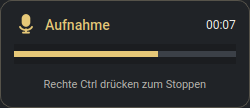
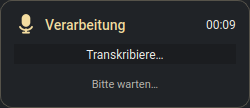
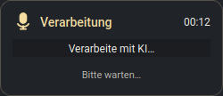
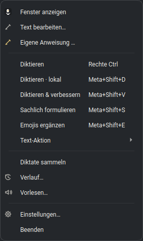

# Blitztext Linux — persönlicher Fork

[](https://github.com/fhroland/blitztext-linux/actions/workflows/blitztext-linux-ci.yml)
[](LICENSE)

[English](README.md) | **Deutsch**

Dies ist der **[persönliche Fork von fhroland](https://github.com/fhroland/blitztext-linux)**
von **[TimInTech/blitztext-linux](https://github.com/TimInTech/blitztext-linux)**.
Basis ist der Original-Commit `73a1e41` (App-Version 0.9.1). Das Linux-Original
ist seinerseits ein Port von [cmagnussen/blitztext-app](https://github.com/cmagnussen/blitztext-app).
MIT-Lizenz und Urheberhinweise bleiben erhalten. Dies ist kein offizielles
Release des Originals und keine separat vertriebene App.

Der Fork ergänzt eine kompakte Aufnahme- und Verarbeitungsanzeige, Start nur im
Systemtray, gespeicherte Auswahl **Lokal / Mit KI**, neue Shortcuts und Anpassungen,
die unter **openSUSE Tumbleweed mit KDE Plasma / Wayland** getestet wurden.
Release-Updates in der App sind **vorübergehend deaktiviert**, damit sie diese
Anpassungen nicht überschreiben. Upstream-Upgrades werden über Git geprüft und
übernommen; die Sperre bleibt bis zu einer bewussten Freigabe bestehen.

Das vollständige [Änderungsprotokoll samt Upgrade-Ablauf](docs/local-customizations.md)
unterscheidet Codeänderungen und zusätzliche lokale Einrichtung.

## Unter openSUSE Tumbleweed getestet

Die lokale Installation wurde manuell eingerichtet und am **28.10.2026** geprüft:

| Komponente | Getestete Einrichtung |
|---|---|
| Desktop | openSUSE Tumbleweed, KDE Plasma, Wayland |
| Python | 3.13.16 in der virtuellen Projektumgebung |
| Spracherkennung | faster-whisper 1.2.1, large-v3-turbo, NVIDIA CUDA |
| GPU | NVIDIA GeForce GTX 1650 Ti, 4 GB VRAM |
| KI-Nachbearbeitung | OpenAI-kompatibler Endpunkt auf einem ASUS Ascent GX10 über Tailscale |
| Eingabe und Einfügen | evdev-Hotkeys; ydotool; in Kate und Konsole getestet |

Dafür wurden CUDA-Bibliothekspfade im lokalen Launcher eingerichtet, das Modell
vorgeladen und dauerhaft im Cache gehalten sowie **PyAV 18.1.0** über
`constraints-local.txt` fixiert. Hinzu kommen KDE-Fenstererkennung mit **kdotool**,
eine Startkorrektur des ydotool-Dienstes und eine KWin-Regel, die den Fokuswechsel
zur Statusbox verhindert. Launcher, Benutzereinstellungen und Desktop-Regeln
werden durch Klonen nicht automatisch eingerichtet. Details stehen unter
[zusätzliche lokale Einrichtung](docs/local-customizations.md#außerhalb-des-repositorys).

**Das übernommene Installationsskript ist weiterhin für Ubuntu/Debian ausgelegt
und lehnt openSUSE ab.** Die erfolgreiche Tumbleweed-Einrichtung bedeutet noch
keinen fertigen openSUSE-Installer. Die GitHub-CI prüft zusätzlich die gesamte
Testsuite unter Ubuntu mit Python 3.11, 3.12 und 3.14; das ersetzt keinen echten
Desktop-Test.

## Aufnahme- und Verarbeitungsbox

Die kompakte **250 × 108 Pixel** große Box erscheint in der Bildschirmmitte über
anderen Fenstern, ohne den Tastaturfokus zu übernehmen. Sie funktioniert auch bei
geschlossenem oder minimiertem Hauptfenster. Besonders praktisch ist sie, wenn
eine ausgeblendete Statusleiste, eine Vollbildanwendung oder das Desktop-Layout
den **Systemtray unsichtbar macht**.

<table>
  <tr><th>Aufnahme</th><th>Transkription</th><th>KI-Nachbearbeitung</th></tr>
  <tr>
    <td></td>
    <td></td>
    <td></td>
  </tr>
</table>

- Während der Aufnahme: echter Mikrofonpegel, Laufzeit und Stopphinweis.
- Danach ersetzt **Transkribiere…** beziehungsweise **Verarbeite mit KI…** die
  Pegelanzeige. Die Box bleibt bis zum Abschluss, Fehler oder Verwerfen sichtbar;
  die gesamte Laufzeit zählt weiter.
- Das Mikrofon übernimmt **dasselbe Symbol und dieselben Statusfarben wie der
  Tray**: Gold für Aufnahme und Hellgold für Verarbeitung. Grün steht für bereit,
  Rot für einen Fehler.
- Blitztext startet nur im Systemtray; das Hauptfenster wird bei Bedarf geöffnet.

Die Bilder sind Aufnahmen der tatsächlichen Qt-Oberfläche mit demonstriertem
Pegel und Zeitwert, ohne Mikrofonzugriff oder private Texte. Sie lassen sich mit
[`scripts/_make_fork_screenshots.py`](scripts/_make_fork_screenshots.py) neu erzeugen.

---

## Weitere Änderungen gegenüber dem Original

- **Gespeicherter Modus:** Lokal / Mit KI und die KI-Aktion bleiben nach einem
  Neustart erhalten. Die normale Aufnahmetaste berücksichtigt diese Auswahl.
- **Start nur im Tray:** Das Hauptfenster muss zum Diktieren nicht geöffnet sein.
- **Rechte Strg allein:** Kombinationen mit dieser Taste starten oder stoppen
  keine Aufnahme.
- **Kontrollierte Upgrades:** In-App-Updates bleiben bis zu einer ausdrücklichen
  Freigabe gesperrt. Neue Originalstände werden über Git geprüft und getestet.
- **KDE- und GPU-Anbindung:** Terminal-Erkennung beim Einfügen, Modell-Vorladen
  und Cache, Decoder-Versionsbeschränkung sowie die Aufnahme-/Verarbeitungsbox.

Die datierte [Änderungshistorie](docs/local-customizations.md#historie) hält diese
Anpassungen und ihre Prüfung fest. Externe Launcher-, Dienst- und KWin-Einstellungen
sind getrennt dokumentiert, damit sie auf einem anderen Rechner nachvollziehbar sind.

## Zweck

Blitztext Linux ist ein Hotkey-gesteuerter Sprachassistent, der gesprochene Sprache in Text umwandelt und direkt in die gerade aktive Anwendung einfügt. Die Transkription läuft standardmäßig lokal über Whisper; ein LLM-Schritt ist optional und wird nur genutzt, wenn du bewusst einen der KI-Workflows (Umformulierung, Ton-Filter, Emoji-Anreicherung) oder das Compose-Fenster auswählst. In der getesteten Einrichtung bleibt das Audio zur Erkennung auf dem Notebook; für die KI-Nachbearbeitung geht nur der erkannte Text an den GX10. Andere Konfigurationen können OpenAI, OpenRouter oder eigene Endpunkte verwenden. Cloud-Transkription überträgt Audio an den Anbieter, Cloud-TTS den vorzulesenden Text.

---

## Features

- **Mehrsprachige Oberfläche (EN/DE):** Schalte die App-Oberfläche zwischen Deutsch und Englisch um – unter **Einstellungen → Allgemein → „Sprache der Oberfläche"** (die Änderung greift nach einem Neustart der App).
- **Compose-Fenster:** Text eintippen, einfügen oder hineindiktieren, eine Text-Aktion wählen und von der KI umschreiben lassen — ganz ohne Mikrofon. Mit Tonfall-Auswahl, eigener Anweisung samt Prompt-Prüfung, Varianten-Navigation und Signatur-Unterstützung.
- **OpenRouter & eigene LLM-Endpunkte:** Nutze OpenRouter oder eine beliebige OpenAI-kompatible API als Alternative zu OpenAI für alle KI-Workflows.
- **Audio-Export:** Speichere die Ausgabe der Vorlesefunktion direkt als Audiodatei.
- **Eigennamen / Begriffe:** Erweitere das Vokabular der KI um eigene Begriffe, Namen oder Fachwörter für perfekte Transkriptionen.
- **Lokale Transkript-Bereinigung:** Vor dem Einfügen bzw. Umschreiben werden Füllwörter („äh“) und Stottern entfernt, Wörter mit denselben Buchstaben wie einer deiner Begriffe erhalten deine Schreibweise („Blitz Text“ → „Blitztext“), und optionale feste Regeln aus `workflows.replacements` in der `config.json` (`{"spoken": "n acht n", "written": "n8n"}`) werden angewendet. Ohne KI, alles andere bleibt unverändert.
- **Globale Hotkeys:** Jederzeit von überall im System aufnehmen.
- **Auto-Paste:** Erkennt Sprache und fügt sie direkt dort ein, wo der Cursor ist.
- **LLM-gestützte Workflows:** Lass die KI deine Sätze professionell umformulieren, emotional filtern oder mit passenden Emojis anreichern.
- **Lokale Verarbeitung:** Optional 100% offline für volle Privatsphäre.

### Workflows und aktuelle Shortcuts

Die globalen Hotkeys werden direkt über `evdev` gelesen; sie sind nicht in der
KDE-Shortcutverwaltung registriert. Meta ist normalerweise die Windows-/Super-Taste.

| Aktion | Tastenkürzel | KI-Nachbearbeitung? |
|---|---|---|
| Start/Stopp mit gespeicherter Auswahl Lokal / Mit KI | **Rechte Strg allein** (lokal eingerichtet) | Abhängig vom gespeicherten Modus |
| Lokal diktieren | **Meta+Shift+D** | Nein |
| Diktieren & verbessern | **Meta+Shift+V** | Ja, mit gewählter Text-Aktion |
| Sachlich formulieren | **Meta+Shift+S** | Ja |
| Emojis ergänzen | **Meta+Shift+E** | Ja |

Rechte Strg im **Toggle-Modus** schaltet beim Loslassen: einmal drücken und
loslassen startet, erneut drücken und loslassen stoppt. Kombinationen wie rechte
Strg+C/X lösen keine Aufnahme aus. Taste und Modus sind unter **Einstellungen →
Spracherkennung** konfigurierbar. Eine neue Konfiguration verwendet weiterhin
**linke Alt / Halten** als Programmvorgabe; rechte Strg / Toggle ist die getestete
lokale Einstellung und kein neuer fest eingebauter Standard.

Die normale Aufnahmetaste verwendet den gespeicherten `preferred_workflow`.
Explizite Tray-Workflows starten dagegen die benannte Aktion, ohne die gespeicherte
Auswahl zu ändern. Der Tray-Eintrag **Diktieren** transkribiert ohne KI-Nachbearbeitung.
KI-Aktionen benötigen einen nutzbaren konfigurierten Endpunkt/Schlüssel. Die alten
Kombinationen Meta+Shift+H/T sind nicht mehr aktiv; Meta+Shift+D steht nun für lokal.

### KI-Workflows

Die KI-Workflows helfen bei Formulierung, Ton und Emojis. Die passenden Einstellungen findest du unter **Einstellungen → Text & KI**:

<div align="center">
  
  <br><br>
</div>

> [!IMPORTANT]
> **Das Feld „API-Key-Umgebung“ ist kein Eingabefeld für den geheimen
> API-Key.** Trage dort nur den Namen der Umgebungsvariable ein, für OpenAI
> beispielsweise `OPENAI_API_KEY` und für OpenRouter `OPENROUTER_API_KEY`.
> Der tatsächliche Schlüssel wird beim Speichern der Einstellungen weder in
> `config.json` noch automatisch in eine andere Datei geschrieben. Lege ihn
> separat in `~/.config/blitztext-linux/secrets.env` ab; `./run.sh` und der
> systemd-User-Service laden diese Datei beim nächsten Start. Eine vollständige
> Anleitung mit Dateiformat und Berechtigungen steht unter [Secrets](#secrets).

**LLM-Anbieter.** Blitztext unterstützt drei Anbieter-Modi, wählbar unter **Einstellungen → Text & KI → „LLM-Anbieter"**:

| Anbieter | Wann verwenden |
| :--- | :--- |
| **OpenAI** (Standard) | Standard-OpenAI-API mit `gpt-4o-mini` oder einem anderen Modell. |
| **OpenRouter** | Zugriff auf hunderte Modelle über einen einzigen API-Key (`OPENROUTER_API_KEY`). Base-URL: `https://openrouter.ai/api/v1`. |
| **Eigener Endpunkt** | Jede OpenAI-kompatible API — „Base-URL" und „LLM-Modell" auf den Anbieter anpassen. |

Für OpenRouter `base_url` auf `https://openrouter.ai/api/v1` setzen und Modell wählen (z. B. `openai/gpt-4o`). Der Name der API-Key-Umgebungsvariable wird unter „API-Key-Umgebung" eingestellt.

**Text-Aktionen.** Das Umschreiben läuft über fünf klar getrennte Aktionen. Du wählst sie unter **Einstellungen → Text & KI → „Text-Aktion"**, im Compose-Fenster oder im ⋯-Menü des Haupt-Widgets:

| Text-Aktion | Wirkung |
| --- | --- |
| **Text verbessern** | Standard: sauber formatierter Text mit korrigierter Grammatik und Zeichensetzung; der gewählte **Ziel-Tonfall** greift. |
| **Kürzen** | Entfernt Füllwörter, Wiederholungen und Umwege, behält aber alle wesentlichen Informationen. |
| **Ausformulieren** | Macht aus Notizen und Fragmenten zusammenhängenden Fließtext — ohne neue Fakten zu ergänzen. |
| **Tonfall ändern** | Ändert gezielt nur den Tonfall (locker / neutral / professionell) und lässt Inhalt, Sprache und Absicht unverändert. |
| **Eigene Anweisung** | Deine eigene Anweisung aus dem Compose-Fenster („Wie soll dein Text klingen?“). **Speichern & für Diktate verwenden** überträgt sie zusätzlich auf den Workflow „Diktieren & verbessern“. |

> Der **Ziel-Tonfall** wirkt bei **Text verbessern** und **Tonfall ändern**. Ältere Konfigurationen mit den früheren neun Schreibstil-Vorlagen werden automatisch auf die nächstliegende Aktion migriert (z. B. „E-Mail – formell“ → **Tonfall ändern**, professionell). Eigennamen/Begriffe bleiben in allen Aktionen erhalten.

### Compose-Fenster

Das **Compose-Fenster** (`✍ Text bearbeiten…` im Tray-Menü oder über das Stift-Symbol im Hauptfenster-Widget) ermöglicht das Entwerfen, Umschreiben und Verfeinern von Texten mit der KI — ganz ohne Sprachaufnahme. Es eignet sich ideal zum Überarbeiten von E-Mails, Notizen oder Nachrichten, bevor sie eingefügt werden.

<div align="center">
  <br>
  
  <br><br>
</div>

**Öffnen:** Klick auf das Tray-Icon → **✍ Text bearbeiten…** oder Klick auf das goldene Stift-Symbol im Hauptfenster-Widget.

**Was du im Compose-Fenster tun kannst:**

| Element | Beschreibung |
| :--- | :--- |
| **Text-Aktion** | Wähle zwischen *Text verbessern*, *Kürzen*, *Ausformulieren*, *Tonfall ändern* oder *Eigene Anweisung*. |
| **Tonfall** | Erscheint dynamisch bei Auswahl von *Tonfall ändern* (Locker, Neutral, Professionell). |
| **Eigene Anweisung …** | Klappt eine eigene Prompt-Karte aus (*„Wie soll dein Text klingen?“*). **Verbessern** wendet sie für den aktuellen Entwurf an; **Speichern & für Diktate verwenden** speichert sie dauerhaft für kommende Sitzungen und Diktat-Workflows. |
| **Prompt prüfen** | Zeigt den exakt zusammengestellten System-Prompt samt Anweisungen vor dem Senden an das Sprachmodell. |
| **Sprachaufnahme hierher umleiten** | Ist diese Option aktiv, landen laufende Diktataufnahmen direkt im Entwurfsfeld statt in der aktiven Anwendung. |
| **Entwurf (linkes Feld)** | Text eintippen, einfügen oder direkt per Sprache hineindiktieren. |
| **Ergebnis (rechtes Feld)** | Zeigt die KI-generierte Fassung direkt neben dem Ausgangstext. |
| **Varianten-Navigation** | Die in dieser Sitzung erzeugten Ergebnisse bleiben verfügbar — über die Pfeile ‹ › oberhalb des Ergebnisfelds durchblätterbar. |
| **Kopieren** | Kopiert das Ergebnis in die Zwischenablage. |
| **Einfügen & Schließen** | Fügt das Ergebnis direkt in die aktive Anwendung ein und schließt das Compose-Fenster. |

<div align="center">
  <br>
  
  <br>
  <sub>Eigene KI-Anweisungen direkt im Compose-Fenster formulieren und den System-Prompt vorab prüfen.</sub>
  <br><br>
</div>

> [!NOTE]
> Signatur und eigener Preset-Text werden unter **Einstellungen → Allgemein** konfiguriert („Signatur für Compose-Fenster“ und „Automatisch nach Generierung anfügen“). Gängige KI-Platzhalter wie `[Ihr Name]` oder `[Your Name]` werden dabei automatisch sauber ersetzt.

### Tray-Symbol und Kontextmenü

Das Mikrofon im System-Tray ist dein Indikator für den aktuellen Zustand:

<div align="center">
  <table>
    <tr>
      <td align="center" width="25%">
        <br><br>
        <b>Grün</b> (IDLE)<br>
        <i>Bereit — wartet auf deinen Einsatz.</i>
      </td>
      <td align="center" width="25%">
        <br><br>
        <b>Gold</b> (RECORDING)<br>
        <i>Aufnahme läuft aktiv.</i>
      </td>
      <td align="center" width="25%">
        <br><br>
        <b>Pale gold</b> (TRANSCRIBING / LLM_REWRITING)<br>
        <i>Magie läuft (Transkription / KI-Umformulierung).</i>
      </td>
      <td align="center" width="25%">
        <br><br>
        <b>Rot</b> (ERROR)<br>
        <i>Ups, etwas ist schiefgelaufen.</i>
      </td>
    </tr>
  </table>
</div>

Das Tray-Kontextmenü gibt dir schnellen Zugriff auf alle Workflows, das Compose-Fenster, Text-Aktionen, Diktat-Modus, Verlauf und Einstellungen:

<div align="center">
  <br>
  
  <br><br>
</div>

> [!NOTE]
> Die Statusbox hält Aufnahme und Verarbeitung auch bei ausgeblendeter Leiste oder verborgenem Tray sichtbar. Der Symbol-Fallback greift nur bei einem nicht ladbaren Symbol; er ersetzt keinen fehlenden Tray-Bereich.

### Hauptfenster: Single-Panel-Widget

Das Hauptfenster ist ein kompaktes, rahmenloses Desktop-Widget mit einheitlicher dunkler Ästhetik, edlen Gold-Akzenten und direkter visueller Rückmeldung:

<div align="center">
  <table>
    <tr>
      <td align="center" width="25%">
        <br><br>
        <b>Bereit</b><br>
        <i>Wartet auf Sprach- oder Mausklick-Eingabe.</i>
      </td>
      <td align="center" width="25%">
        <br><br>
        <b>Aufnahme</b><br>
        <i>Laufender Timer und Audiowellen-Balken.</i>
      </td>
      <td align="center" width="25%">
        <br><br>
        <b>Verarbeitung</b><br>
        <i>Rotierender goldener Fortschrittsring.</i>
      </td>
      <td align="center" width="25%">
        <br><br>
        <b>Aktions-Menü</b><br>
        <i>Details zur gewählten Seite: Aktion, Stil, KI-Anbieter, Whisper-Modell.</i>
      </td>
    </tr>
  </table>
</div>

- **Zentrales Gold-Mikrofon:** Markanter kreisrunder Button mit metallischem Farbverlauf und Blitz-Aussparung. Klick startet oder beendet die Aufnahme.
- **Dynamische visuelle Rückmeldung:**
  - **Bereit (IDLE):** Grüner Statuspunkt und Zeitanzeige (`Bereit: 00:00`).
  - **Aufnahme (RECORDING):** Gelber Statuspunkt, sekundengenaue Zeitanzeige und animierte Wellenbalken links und rechts des Mikrofons.
  - **Verarbeitung (TRANSCRIBING):** Rotierender goldener Kreisbogen um das Mikrofon (`Transkribiere…`).
- **Umschalter Lokal | Mit KI:** Zwei Knöpfe direkt unter dem Mikrofon. **Lokal** = Transkription ohne KI-Nachbearbeitung; mit einem lokalen Spracherkennungs-Backend bleibt das Audio auf dem Rechner. **Mit KI** ergänzt die Bearbeitung durch den konfigurierten KI-Endpunkt, zum Beispiel den GX10. Die gewählte Seite ist gold; die Zustandszeile darunter (zum Beispiel `Lokal · Whisper base` oder `Mit KI · OpenAI · Verbessern`) zeigt, was die nächste Aufnahme tut, und öffnet per Klick das Detail-Popup. Hotkey-Workflows stellen den Umschalter auf die passende Seite, während der Aufnahme ist er gesperrt.
- **Kompakte Werkzeugleiste:**
  - ✍ **Compose-Button** (hervorgehobenes Stift-Symbol): Öffnet das Entwurfsfenster für Texteingabe und KI-Verfeinerung.
  - 🕒 **Verlauf-Button** (mit Zähler-Badge): Öffnet den Transkript- und Diktat-Verlauf.
  - 🔊 **Vorlesen-Button** (Lautsprecher-Symbol): Öffnet das TTS-Fenster zur Sprachausgabe.
  - ⋯ **Mehr-Button** (gleiches Popup wie die Zustandszeile): Zeigt nur die Felder, die zur gewählten Seite passen — *Lokal*: Whisper-Modell; *Mit KI*: Aktion (*Diktieren & verbessern*, *Sachlich formulieren*, *Emojis ergänzen*), Schreibstil für *Diktieren & verbessern* (*Kürzen*, *Ausformulieren*, *Tonfall ändern*, *Eigene Anweisung*), KI-Anbieter (OpenAI oder OpenRouter; einen eigenen Endpunkt änderst du nur in den Einstellungen) und Whisper-Modell. Ein **Fertig**-Knopf schließt das Popup; *Sammel-Diktat* und *Verwerfen* stehen darunter. Der Anbieterwechsel braucht die passende API-Key-Variable, größere Whisper-Modelle fragen vorher, weil sie heruntergeladen werden können.
- **Einstellungs-Zahnrad:** Kleiner ⚙-Knopf in der Titelleiste neben Minimieren und Schließen; öffnet den Konfigurations-Dialog.

*Das Widget bleibt beim Start geschlossen. Über **Fenster anzeigen** oder einen Klick auf das Tray-Symbol lässt es sich öffnen. Schließen blendet es aus, die App läuft im Tray weiter. Die Auswahl Lokal / Mit KI einschließlich KI-Aktion wird als `preferred_workflow` gespeichert und beim Neustart wiederhergestellt; explizite Workflow-Shortcuts überschreiben diese Vorgabe nicht.*

### Diktat, Verlauf und Vorlesen

Zusätzlich zu den Workflows bietet das Tool drei Komfort-Funktionen:

<div align="center">
  <br>
  
  &nbsp;&nbsp;
  
  <br><br>
</div>

| Menüpunkt | Beschreibung |
| :--- | :--- |
| **Diktat-Modus** | Umschalter. Ist er aktiv, werden alle Transkripte als Diktat-Einträge gesammelt und einzeln als Markdown-Datei gespeichert. Im Verlauf erscheint dann eine Schaltfläche **Zusammenführen**, die alle Einträge kombiniert und in die Zwischenablage kopiert. |
| **Verlauf…** | Öffnet ein Fenster mit den letzten Transkripten. Pro Eintrag: In Zwischenablage kopieren oder löschen. Der **Schließen**-Knopf oder <kbd>Esc</kbd> schließt das Fenster. |
| **Vorlesen…** | Lässt dir beliebigen Text vorlesen — lokal per **Piper TTS** (Standard) oder optional über **OpenAI Cloud-TTS** (inklusive Anbieter-, Stimmen- und Modellauswahl). Nutze die Schaltfläche **Exportieren**, um die Audioausgabe als Datei zu speichern. |

> [!NOTE]
> **Diktat-Notizen** werden ausschließlich in einen Ordner **innerhalb des Home-Verzeichnisses** geschrieben (Schutz gegen Pfad-Ausbruch), mit Berechtigungen `0o600`.

> [!IMPORTANT]
> **Piper TTS** muss für die Vorlesefunktion (sowie Stimmen) installiert sein:
> ```bash
> .venv/bin/pip install piper-tts
> # Stimmen (.onnx + .onnx.json) nach ~/.local/share/piper-voices/ legen
> ```
> Fehlt Piper oder eine Stimme, zeigt das Vorlese-Fenster einen Installationshinweis; alle übrigen Funktionen bleiben nutzbar. Optionale Desktop-Benachrichtigungen nutzen `notify-send` (Paket `libnotify-bin`).

> [!NOTE]
> **OpenAI Cloud-TTS** ist eine optionale Alternative zu Piper. Voraussetzung: das `openai`-Paket (`.venv/bin/pip install openai`) und ein gültiger Key in der Umgebungsvariable `OPENAI_API_KEY` (siehe [Secrets](#secrets) unten). Beim ersten Umschalten auf den Anbieter „OpenAI Cloud" fragt das Vorlese-Fenster einmalig nach Bestätigung, da der eingegebene Text zur Synthese an die OpenAI-Server gesendet wird. Piper bleibt Standard und arbeitet vollständig lokal.

---

## Installation & Start

Für unsere Anpassungen **diesen Fork** klonen:

```bash
git clone https://github.com/fhroland/blitztext-linux.git
cd blitztext-linux
```

Für **openSUSE Tumbleweed** ist die getestete manuelle Einrichtung in
[local-customizations.md](docs/local-customizations.md#außerhalb-des-repositorys)
dokumentiert. Dort stehen Launcher, CUDA-Pfade, Dienste und KWin-Anpassungen.
Das ist die Dokumentation einer funktionierenden Installation, noch kein
allgemeiner Ein-Befehl-Installer. Benutzereinstellungen und Schlüssel müssen
für eine neue Installation separat eingerichtet werden.

Für **Ubuntu/Debian** steht das übernommene `bash scripts/install.sh` bereit.
Die ursprünglichen Schritte und Paketlisten stehen in der
[Installationsanleitung des Originals](https://github.com/TimInTech/blitztext-linux/blob/73a1e41/README.de.md#installation--start).
Sie beschreibt die Originalvorgaben. Die zusätzlichen Versionsbeschränkungen und
Desktop-Anpassungen dieses Forks sind bei Bedarf separat zu übernehmen; den
Debian-Installer nicht unter openSUSE ausführen.

Nach Einrichtung von Abhängigkeiten und Konfiguration über den lokalen Launcher
oder den Benutzer-Dienst starten. `./run.sh` startet den Checkout direkt, ergänzt
aber nicht die CUDA-Bibliothekspfade des lokalen Launchers.

```bash
systemctl --user start blitztext-linux.service
```

Die Anwendung startet **nur im Tray**, ohne Hauptfenster. Über **Fenster anzeigen**
im Tray-Menü lässt es sich bei Bedarf öffnen. Die Statusbox erscheint unabhängig
davon während Aufnahme und Verarbeitung.

## Aufnahme verwerfen

Während einer Aufnahme erscheint **Verwerfen** direkt bei der Aufnahmesteuerung und im Tray-Menü. Die Aktion beendet die Aufnahme und löscht das temporäre Audio, ohne Transkription oder KI-Verarbeitung zu starten. **Stopp** beendet und verarbeitet die Aufnahme weiterhin. Vorhandener Text und Verlauf bleiben beim Verwerfen erhalten.

## Updates vorübergehend deaktiviert

Release-Ersetzung und auch manuelle **In-App-Updateprüfungen, Downloads und
Installationen** sind in diesem Fork gesperrt. Der ursprüngliche Updater arbeitete
bereits nur auf Anforderung; unsere zusätzliche Sperre schützt den angepassten
Code auch vor einem versehentlichen Klick.

Die Datei `.updates-disabled` oder `BLITZTEXT_DISABLE_UPDATES=1` aktiviert die
Sperre; der lokale Launcher setzt die Variable zusätzlich. `run.sh` startet unter
der Sperre weiterhin den Checkout und wechselt nicht zu vorbereiteten
Release-Verzeichnissen. Die Sperre läuft nicht von selbst ab.

Upgrades werden in einem separaten Git-Branch/Arbeitsverzeichnis vorbereitet,
mit unseren Anpassungen zusammengeführt, getestet und bewusst übernommen.
Siehe [Upgrade-Ablauf](docs/local-customizations.md#upgrades-kontrolliert-übernehmen).
Die ursprüngliche [Release-Paketdokumentation](docs/release-updates.md) bleibt als
Referenz erhalten; sie beschreibt keinen freigeschalteten Updatekanal dieses Forks.

## Konfiguration

Alles wird lokal unter `~/.config/blitztext-linux/config.json` gespeichert. Diese Datei enthält keine Secrets — der OpenAI-/OpenRouter-Key wird aus einer Umgebungsvariable gelesen (siehe [Secrets](#secrets)). Die Konfigurationsdatei lässt sich direkt aus den Einstellungen öffnen: **Einstellungen → Allgemein → „Konfigurationsdatei öffnen"**.

Der Einstellungs-Dialog enthält Spracherkennung, Text & KI, Allgemein und Updates:

<div align="center">
  
  <br><i>Spracherkennung — Whisper-Modell, Backend, Sprache, Hotkey-Modus und Aufnahmetaste.</i><br><br>
  
  <br><i>Text &amp; KI — System-Prompt, API-Key-Umgebung, LLM-Anbieter, Base-URL, Modell, Text-Aktion und Emoji-Dichte.</i><br><br>
  
  <br><i>Allgemein — Auto-Paste, Diktat-Notizordner, Verlaufsgröße, Sprache der Oberfläche und Signatur.</i><br><br>
</div>

> [!IMPORTANT]
> Die Konfigurationsdatei wird automatisch mit restriktiven Dateiberechtigungen (**`0o600` / `chmod 600`**) gespeichert.

<details>
<summary><b>Beispiel-Konfiguration mit Programmvorgaben & Felderklärung</b></summary>

Das Beispiel zeigt Programmvorgaben. Die getestete lokale Einrichtung verwendet dagegen faster-whisper, large-v3-turbo, rechte Strg / Toggle und einen eigenen KI-Endpunkt. Diese privaten Einstellungen werden nicht mitgeliefert.

```json
{
  "model": "base",
  "language": "de",
  "ui_language": "de",
  "backend": "openai-whisper",
  "hotkey_mode": "hold",
  "transcription_hotkey": "KEY_LEFTALT",
  "preferred_workflow": "transcription",
  "openai_api_key_env": "OPENAI_API_KEY",
  "autopaste": true,
  "paste_key_delay_ms": 80,
  "audio_device": "@DEFAULT_SOURCE@",
  "notes_folder": "~/Blitztext-Notizen",
  "history_size": 50,
  "llm_provider": "openai",
  "llm_base_url": "",
  "llm_model": "gpt-4o-mini",
  "tts_provider": "piper",
  "tts_voice": "",
  "tts_openai_model": "gpt-4o-mini-tts",
  "tts_openai_voice": "marin",
  "tts_speed": 1.0,
  "compose_signature_text": "",
  "compose_signature_auto_append": false,
  "compose_custom_preset_text": "",
  "workflows": {
    "text_improver_tone": "neutral",
    "writing_preset": "standard",
    "emoji_density": "medium",
    "dampf_system_prompt": ""
  }
}
```

- **model**: Whisper-Modellgröße (`tiny`, `base`, `small`, `medium`, `large`, `large-v2`, `large-v3`, `large-v3-turbo`). Standard: `base`.
- **language**: Transkriptions-Sprache (`de`, `en`) oder `auto`.
- **ui_language**: Sprache der App-Oberfläche (`de` oder `en`). Standard: `de`. Änderungen greifen nach einem Neustart.
- **backend**: `openai-whisper` oder `faster-whisper` (lokal), oder `openrouter` / `openai-cloud` (Cloud-Transkription mit `openai/gpt-4o-transcribe` / `gpt-4o-transcribe`). **Datenschutz:** Bei einem Cloud-Backend wird die Aufnahme an OpenRouter bzw. OpenAI gesendet; der Schlüssel kommt aus `OPENROUTER_API_KEY` / `OPENAI_API_KEY` (oder den konfigurierten Variablennamen) und wird nie in der Config gespeichert. Der explizite Shortcut *Diktieren · lokal* erzwingt bei konfiguriertem Cloud-Backend die lokale Erkennung mit `faster-whisper`. Für die Auswahl *Lokal* im Hauptfenster dieses Stands muss wie in der getesteten Einrichtung ein lokales Spracherkennungs-Backend konfiguriert sein.
- **hotkey_mode**:
  - `toggle`: Einmal drücken startet, erneutes Drücken beendet.
  - `hold`: Aufnahme läuft solange der Hotkey gedrückt wird. Tastendrücke unter 150 ms werden verworfen; leere Aufnahmen kehren ohne dauerhaften Fehlerzustand zu Bereit zurück.
- **transcription_hotkey**: Aufnahmetaste des globalen Hotkey-Daemons. Programmvorgabe: `KEY_LEFTALT`; lokal getestet: `KEY_RIGHTCTRL` mit `hotkey_mode=toggle`.
- **preferred_workflow**: Gespeicherte Auswahl Lokal / Mit KI, etwa `transcription`, `local`, `text_improver`, `dampf_ablassen` oder `emoji_text`. Vorgabe: `transcription`. Die normale Aufnahmetaste verwendet diese Auswahl.
- **openai_api_key_env**: Name der Umgebungsvariable für den API-Key. Standard: `OPENAI_API_KEY`. Für OpenRouter: `OPENROUTER_API_KEY`.
- **tts_openai_api_key_env**: Umgebungsvariable für den Key von OpenAI Cloud-TTS, unabhängig vom LLM-Anbieter. Standard: `OPENAI_API_KEY`.
- **llm_provider**: `openai` (Standard), `openrouter` oder `custom`.
- **llm_base_url**: Eigene API-Base-URL. Leer = OpenAI-Standard. Für OpenRouter: `https://openrouter.ai/api/v1`.
- **llm_model**: Modellname beim Anbieter, z. B. `gpt-4o-mini` (OpenAI) oder `openai/gpt-4o` (OpenRouter).
- **autopaste**: Fügt per `ydotool` ein.
- **paste_key_delay_ms**: Verzögerung in Millisekunden zwischen simulierten Tastenereignissen für Auto-Paste. Standard: `80`.
- **audio_device**: Name der Audioquelle.
- **notes_folder**: Ordner für Diktat-Notizen; er muss innerhalb deines Home-Verzeichnisses liegen. Standard: `~/Blitztext-Notizen`.
- **history_size**: Anzahl der zuletzt gespeicherten Transkripte im Verlaufsfenster. Auf 10-100 begrenzt. Standard: `50`.
- **compose_signature_text**: Signaturtext, der im Compose-Fenster angehängt wird.
- **compose_signature_auto_append**: Signatur nach jeder Generierung im Compose-Fenster automatisch anhängen (`true`/`false`).
- **compose_custom_preset_text**: Freier System-Prompt für die Option „Eigenes Preset…" im Compose-Fenster.
- **tts_provider**: TTS-Anbieter für „Vorlesen" — `piper` (lokal, Standard) oder `openai` (Cloud).
- **tts_voice**: Stimmenname für den aktiven TTS-Anbieter. Standard: `""` = Piper-Standardstimme.
- **tts_openai_model** / **tts_openai_voice**: Modell und Stimme für OpenAI Cloud-TTS (Standard: `gpt-4o-mini-tts`, `marin`).
- **tts_openai_consent**: `true`, sobald die einmalige Datenschutz-Bestätigung für Cloud-TTS erteilt wurde. Standard: `false`.
- **tts_speed**: Sprechgeschwindigkeit für „Vorlesen" als Multiplikator. Standard: `1.0`.
- **workflows**: Feintuning von Tonalität (`text_improver_tone`), Text-Aktion (`writing_preset`), Emojis (`emoji_density`) und dem Dampf-Prompt (`dampf_system_prompt`).
</details>

---

## Secrets

API-Keys werden niemals in `config.json` gespeichert — sie werden zur Laufzeit aus Umgebungsvariablen gelesen.

**Empfohlen: `secrets.env`.** Lege deine(n) Key(s) in `~/.config/blitztext-linux/secrets.env` ab, ein `NAME=WERT`-Paar pro Zeile — der Variablenname richtet sich nach dem unter **Einstellungen → Text & KI → „API-Key-Umgebung"** gewählten Anbieter (z. B. die OpenAI-Variable für OpenAI, die OpenRouter-Variable für OpenRouter), `WERT` ist der geheime Key von diesem Anbieter:

```bash
<VARIABLENNAME>=<dein-geheimer-wert>
```

`./run.sh` und der systemd-User-Service laden diese Datei automatisch. `config.json` speichert nur den *Namen* der zu lesenden Umgebungsvariable (`openai_api_key_env`), niemals den Key selbst.

- Welche Variable verwendet wird, hängt von **Einstellungen → Text & KI → „API-Key-Umgebung"** und dem gewählten LLM-Anbieter ab (`OPENAI_API_KEY` für OpenAI, `OPENROUTER_API_KEY` für OpenRouter, oder ein eigener Name für einen eigenen Endpunkt).
- Ohne gültigen Key sind die LLM-Workflows (`Diktieren & verbessern`, `Sachlich formulieren`, `Emojis ergänzen`) und OpenAI Cloud-TTS deaktiviert bzw. schlagen mit einer Fehlermeldung fehl; lokale Transkription und Piper-TTS funktionieren weiterhin.
- Committe niemals `secrets.env`, API-Keys oder Tokens in git. Sollte ein Key jemals offengelegt werden (z. B. versehentlich committet oder in ein Issue eingefügt), rotiere ihn sofort beim Anbieter.
- `config.json` wird mit restriktiven Rechten (`0o600`) geschrieben; die gleiche Erwartung gilt für `secrets.env`.

---

## Tests

Gesamte Testsuite auf Ubuntu/Debian ausführen:

```bash
env -u OPENAI_API_KEY WHISPER_GUI_TESTS=1 QT_QPA_PLATFORM=offscreen .venv/bin/python -m pytest tests/ -q
```

Unter openSUSE `--ignore=tests/test_install_script.py` ergänzen: Diese Installer-Tests
setzen Ubuntu/Debian voraus. Die gesamte Ubuntu-Suite läuft zusätzlich in der
[CI dieses Forks](https://github.com/fhroland/blitztext-linux/actions/workflows/blitztext-linux-ci.yml).

`bash scripts/verify.sh` führt sitzungsabhängige Diagnosen für X11-, Wayland- und Clipboard-Backends aus — hilfreich nach der Installation oder bei der Fehlersuche zu Hotkeys/Paste-Verhalten. Die Ausgabe ist Diagnosehilfe, kein Supportversprechen; siehe die dort ausgegebenen Kompatibilitätshinweise für deine Desktop-Sitzung.

---

## Flatpak-MVP-Status

`packaging/flatpak/` enthält einen **experimentellen** Flatpak-Manifest-Spike — kein Release-Kanal und nicht auf Flathub veröffentlicht.

- Eine strukturelle Validierung (`flatpak-builder --show-manifest` / `--show-deps`) sowie ein vollständiger lokaler Build (inklusive Download von `org.kde.Platform`/`org.kde.Sdk` 6.8) waren auf einer Entwicklungsmaschine beide erfolgreich.
- Die KDE-6.8-Runtime ist upstream als EOL markiert; sie baut und läuft für diesen MVP dennoch. Ein Runtime-Bump auf 6.10 ist ein möglicher Folge-Spike, hier aber nicht umgesetzt.
- Innerhalb der Flatpak-Sandbox sind mehrere Funktionen bewusst deaktiviert oder eingeschränkt: keine globalen Hotkeys (kein evdev-/Input-Geräte-Zugriff), kein `ydotool`-Auto-Paste (Zwischenablage-Kopie funktioniert weiterhin über den Qt-Fallback), keine lokale Whisper-Transkription (aus `requirements-flatpak.txt` wegen der Größe ausgeklammert — Cloud-Transkription/LLM-Workflows funktionieren weiterhin mit `--share=network`) und keine Desktop-Benachrichtigungen (`notify-send` ist nicht gebündelt).
- Es gibt kein Signing, keine AppStream-Metadaten, kein `.desktop`-File und kein paketiertes Release für diesen Spike.

Details zu Manifest-Umfang, Build-Befehlen und bekannten Abweichungen von Flathub-Konventionen siehe [`packaging/flatpak/README.md`](packaging/flatpak/README.md).

---

## Bekannte Grenzen

- **Linux Exclusive:** Nur für Linux-Systeme.
- **Wayland Fokus:** Entwickelt für Wayland (`wl-clipboard`, `ydotool`).
- **Datenschutz:** Lokale Workflows bleiben zu 100% auf deinem Rechner. OpenAI oder OpenRouter wird nur bei Bedarf für LLM, Cloud-TTS oder Cloud-Transkription (Backend `openrouter` / `openai-cloud`, das die Aufnahme sendet) kontaktiert.
- **Sicherheit (`evdev` & `input`-Gruppe):** Das Tool liest Input global über `/dev/input/event*`. Auf System-Ebene bedeutet dies, dass alle Prozesse des Benutzers Eingaben mitlesen könnten (Trade-off unter Wayland ohne XDG GlobalShortcuts). Nutze Blitztext nur in Umgebungen, denen du vertraust!
- **Flatpak-Sandbox:** Siehe [Flatpak-MVP-Status](#flatpak-mvp-status) oben — globale Hotkeys, Auto-Paste, lokales Whisper und Desktop-Benachrichtigungen sind innerhalb der Sandbox nicht verfügbar.

---

## Entwicklung

Dieses Projekt wurde mit Unterstützung künstlicher Intelligenz (AI-assisted) entworfen. Architektur, Code und Tests wurden manuell gesichtet und auf Funktion/Sicherheit lokal verifiziert. Siehe [CONTRIBUTING.md](CONTRIBUTING.md) für Hinweise, wie du Änderungen vorschlagen kannst.

<details>
<summary><b>Verzeichnisüberblick</b></summary>

```text
.
├── app/
│   ├── __init__.py
│   ├── audio_recorder.py   # PulseAudio/PipeWire-Aufnahme via parec
│   ├── blitztext_linux.py  # PyQt6-Hauptanwendung (System-Tray)
│   ├── compose_window.py   # Compose-Fenster für textbasiertes KI-Umschreiben
│   ├── config.py           # Konfigurations-Manager
│   ├── history_panel.py    # Transkript-Verlauf-Panel
│   ├── hotkey_service.py   # evdev-basierter Hotkey-Daemon
│   ├── i18n.py             # Übersetzungen (DE/EN) für die Oberfläche
│   ├── llm_service.py      # OpenAI / OpenRouter / eigene Endpunkte
│   ├── main_window.py      # Hauptanwendungsfenster
│   ├── paste_service.py    # Wayland-Clipboard-Integration
│   ├── recording_overlay.py # Aufnahme-/Verarbeitungsbox mit Pegel und Laufzeit
│   ├── transcribe.py       # Whisper-Transkription
│   ├── tts_window.py       # Vorlese-Fenster mit Audio-Export
│   ├── update_policy.py    # Lokale Updatesperre
│   ├── workflows.py        # Workflow-Definitionen
│   └── writing_presets.py  # Text-Aktionen und Migration alter Presets
├── packaging/flatpak/      # Experimenteller Flatpak-MVP-Spike (siehe oben)
├── tests/                  # Test-Suite
└── README.md               # Englische Fassung (diese Datei: README.de.md)
```
</details>

---

## Legal / Impressum & Datenschutz (Original-Projekt)

Dieses Projekt ist ein Linux-Port der macOS-Anwendung "Blitztext". Der Fairness halber und zur korrekten Attribution verweisen wir auf die rechtlichen Angaben des Original-Projekts:

Das Original-Projekt ist ein experimentelles, nicht-kommerzielles Open-Source-Projekt unter der MIT-Lizenz. Die zugehörige Website ([blitztext.de](https://blitztext.de/)) wird betrieben von der Blackboat Internet GmbH:

- Impressum: https://www.blackboat.com/impressum
- Datenschutz / Privacy: https://www.blackboat.com/datenschutz

---

<div align="center">
  <sub>Erstellt mit ❤️ (und ein bisschen KI-Hilfe).</sub>
</div>

### Historische Original-Release-Notizen (v0.9.1): Verwerfen, Updater und Cloud-Transkription

Eine laufende Aufnahme lässt sich jetzt mit **Verwerfen** abbrechen (Hauptfenster und Tray-Menü): Das temporäre Audio wird gelöscht, nichts wird transkribiert. Das Original führte In-App-Release-Updates ein; dieser Fork sperrt diesen Updateweg derzeit. <kbd>Esc</kbd> schließt das Verlaufsfenster und das Diktat-Popup. Die Cloud-Backends `openrouter` und `openai-cloud` stehen in den Einstellungen bereit; siehe Datenschutz-Hinweis bei `backend`.

### Historische Original-Release-Notizen (v0.9.0): Schalter Lokal | Mit KI und sicherere Aufnahme

Das Hauptfenster hat einen sichtbaren Schalter Lokal | Mit KI, schnelle Umschalter für KI-Anbieter und Whisper-Modell sowie ein kleines Einstellungs-Zahnrad. Diktierter Text wird lokal bereinigt (Begriffe zusammenführen, Ersetzungen, Füllwörter, Stottern), bevor er eingefügt oder umgeschrieben wird.

KI-Aufnahmen ohne nutzbaren Schlüssel werden abgelehnt, bevor die Audioaufnahme startet, per Button wie per Hotkey. Das Voice-Routing ins Compose-Fenster funktioniert weiter ohne Schlüssel. Eigene Variablennamen für Schlüssel (nur Namen, nie Schlüsselwerte) bleiben bei Anbieterwechseln und Neustarts erhalten, und ein fehlgeschlagenes Speichern der Config hinterlässt keine Temp-Datei mehr.
