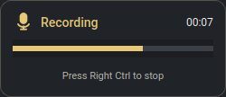
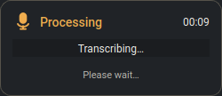
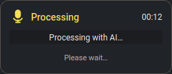
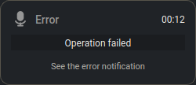
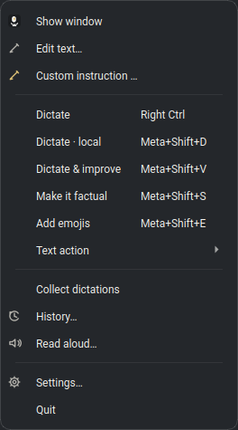

# Blitztext Linux — personal fork

[](https://github.com/fhroland/blitztext-linux/actions/workflows/blitztext-linux-ci.yml)
[](LICENSE)

**English** | [Deutsch](README.de.md)

This is [fhroland's personal fork](https://github.com/fhroland/blitztext-linux)
of **[TimInTech/blitztext-linux](https://github.com/TimInTech/blitztext-linux)**,
based on upstream commit `73a1e41` (app version 0.9.1). The Linux original is
itself a port of [cmagnussen/blitztext-app](https://github.com/cmagnussen/blitztext-app).
Credit, the MIT license, and upstream copyright notices are retained. This is
not an official upstream release or a separately distributed app.

This fork adds a compact recording/processing indicator, tray-only startup,
remembered Local/With AI selection, revised hotkeys, and changes tested on
**openSUSE Tumbleweed with KDE Plasma / Wayland**. In-app release updates are
**temporarily disabled** to protect these changes; upstream upgrades are reviewed
and merged through Git. The lock stays in place until deliberately lifted.

The complete [change record and upgrade procedure](docs/local-customizations.md)
also distinguishes repository changes from machine-specific setup.

## Tested on openSUSE Tumbleweed

The local installation was manually set up and tested on **2026-10-28**:

| Component | Tested setup |
|---|---|
| Desktop | openSUSE Tumbleweed, KDE Plasma, Wayland |
| Python | 3.13.16 in the project's virtual environment |
| Speech recognition | faster-whisper 1.2.1, large-v3-turbo, NVIDIA CUDA |
| GPU | NVIDIA GeForce GTX 1650 Ti, 4 GB VRAM |
| AI rewriting | OpenAI-compatible endpoint on an ASUS Ascent GX10 over Tailscale |
| Input and pasting | evdev hotkeys; ydotool; tested in Kate and Konsole |

The setup includes CUDA library paths in a local launcher, model preloading and
permanent caching, **PyAV 18.1.0** pinned in `constraints-local.txt`, KDE window
detection through **kdotool**, a ydotool service restart adjustment, and a KWin
rule that prevents the indicator from taking focus. These local launcher,
configuration, and desktop rules are not installed automatically by cloning.
See the [deployment notes](docs/local-customizations.md#außerhalb-des-repositorys).

**The inherited installer still targets Ubuntu/Debian and rejects openSUSE.**
The successful Tumbleweed setup does not imply a completed openSUSE installer.
GitHub CI additionally checks the complete suite on Ubuntu with Python 3.11,
3.12, and 3.14; this is separate from native desktop testing.

## Recording and processing indicator

The compact **250 × 108** indicator appears in the centre of the screen, above
other windows, without taking keyboard focus. It works with the main window
closed or minimized and is especially useful when an auto-hidden panel, a
full-screen application, or the desktop layout keeps the **system tray out of view**.

<table>
  <tr><th>Recording</th><th>Transcribing</th><th>AI rewriting</th></tr>
  <tr>
    <td></td>
    <td></td>
    <td></td>
  </tr>
</table>

- During recording: the actual microphone level, elapsed time, and stop hint.
- After recording: the level is replaced by **Transcribing…** or
  **Processing with AI…**. The box stays open and the total elapsed time continues
  until the workflow finishes or is discarded. On failure, a grey error indicator
  remains for four seconds; the tray stays grey until the next recording.
- The microphone uses the **same icon and status colours as the tray**:
  **red = recording**, **orange = transcribing**, **yellow = AI rewriting**,
  **grey = error**, **green = ready**. These colours are separate from gold UI accents.
- Blitztext starts in the tray; the main window opens only on request.

**Error details in KDE:** a failed operation sends one critical desktop notification
grouped under **Blitztext**, with a title naming the failed step and the error cause
in its body. Details can be read in KDE's notification centre/history, subject to
the desktop's notification settings. Keys and credentials are redacted. If native
delivery via `notify-send` is unavailable, a Qt tray notification is used as fallback.

<p><br>Failure: visible for four seconds; details appear in the error notification.</p>

These are captures of the actual Qt widgets with a synthetic demonstration level
and timer, without microphone access or private text. They can be reproduced with
[`scripts/_make_fork_screenshots.py`](scripts/_make_fork_screenshots.py).

---

## Other changes from upstream

- **Remembered mode:** Local / With AI and the chosen AI action are saved and
  restored after restart. The normal recording key follows that preference.
- **Tray-only startup:** closing the main window does not stop dictation.
- **Right Ctrl alone:** modifier combinations no longer start or stop recordings.
- **Controlled upgrades:** in-app updates remain locked until explicitly re-enabled;
  upgrades are reviewed in Git and tested before deployment.
- **KDE and GPU integration:** terminal-aware paste, model preload/cache, decoder
  version constraint, and the dedicated recording/processing box.

The dated [change history](docs/local-customizations.md#historie) records these
changes and their validation. External launcher/service/KWin configuration is
listed separately so it can be reproduced on another machine.

## Purpose

Blitztext Linux is a hotkey-driven voice assistant that turns speech into text and pastes it directly into whatever application has focus. Transcription runs locally via Whisper by default; an LLM step is optional and only used when you explicitly pick one of the AI workflows (rephrase, tone filter, emoji enrichment) or the Compose window. The tested setup transcribes audio on the notebook and sends only recognized text to the configured GX10 for AI rewriting. Other configurations can use OpenAI, OpenRouter or a custom endpoint; cloud transcription sends audio to that provider, while Cloud TTS sends the text to be spoken.

---

## Features

- **Multilingual interface (EN/DE):** Switch the app interface between German and English under **Settings → General → "Interface language"** (takes effect after restarting the app).
- **Compose window:** Type, paste, or dictate any text, pick a text action, and let the AI rewrite it — no microphone needed. Includes tone selector, custom instruction with prompt inspection, variant navigation, and signature support.
- **OpenRouter & custom LLM endpoints:** Use OpenRouter or any OpenAI-compatible API as an alternative to OpenAI for all AI workflows.
- **Audio export:** Save read-aloud output as an audio file directly from the Read Aloud window.
- **Custom names / terms:** Extend the AI's vocabulary with your own terms, names, or technical words for perfect transcriptions.
- **Local transcript cleanup:** Before pasting or rewriting, hesitation sounds („äh“) and stutters are removed, words that spell one of your terms with the same letters get your spelling („Blitz Text“ → „Blitztext“), and optional fixed rules from `workflows.replacements` in `config.json` (`{"spoken": "n acht n", "written": "n8n"}`) are applied. No AI involved, nothing else is changed.
- **Global hotkeys:** Record from anywhere in the system at any time.
- **Auto-paste:** Detects speech and pastes it right where your cursor is.
- **LLM-powered workflows:** Let the AI rephrase your sentences professionally, filter them emotionally, or enrich them with fitting emojis.
- **Local processing:** Optionally 100% offline for full privacy.

### Workflows and current hotkeys

Global hotkeys are read directly through `evdev`; they are not registered in
KDE's shortcut manager. Meta normally means the Windows/Super key.

| Action | Shortcut | AI rewriting? |
|---|---|---|
| Start/stop using the saved Local / With AI mode | **Right Ctrl alone** (configured local setup) | Depends on the saved mode |
| Dictate locally | **Meta+Shift+D** | No |
| Dictate & improve | **Meta+Shift+V** | Yes, using the selected text action |
| Make it factual | **Meta+Shift+S** | Yes |
| Add emojis | **Meta+Shift+E** | Yes |

Right Ctrl in **toggle** mode triggers on release: press and release once to
start, then again to stop. Combinations such as Right Ctrl+C/X do not trigger
recording. The recording key/mode is configurable under **Settings → Speech
Recognition**; a clean configuration still defaults to **Left Alt / hold**.
Right Ctrl / toggle is the tested local setting, not a new hard-coded default.

The normal recording key uses the saved `preferred_workflow`. An explicit tray
workflow starts that named action without changing the saved selection; the tray
item **Dictate** performs transcription without AI rewriting. AI actions require
a usable configured endpoint/key. The old Meta+Shift+H/T combinations are no
longer active; Meta+Shift+D now means local dictation.

### AI workflows

The AI workflows help with phrasing, tone, and emojis. You'll find the relevant settings under **Settings → Text & AI**:

<div align="center">
  
  <br><br>
</div>

> [!IMPORTANT]
> **“API key environment” is not an input field for the secret API key.** Enter
> only the environment-variable name there, such as `OPENAI_API_KEY` for OpenAI
> or `OPENROUTER_API_KEY` for OpenRouter. Saving the settings does not write the
> actual key to `config.json` or automatically create another file for it.
> Store the key separately in `~/.config/blitztext-linux/secrets.env`; `./run.sh`
> and the systemd user service load that file on the next start. See
> [Secrets](#secrets) for the complete file format and permission instructions.

**LLM providers.** Blitztext supports three provider modes, selectable under **Settings → Text & AI → "LLM provider"**:

| Provider | When to use |
| :--- | :--- |
| **OpenAI** (default) | Standard OpenAI API with `gpt-4o-mini` or any other model. |
| **OpenRouter** | Access hundreds of models via a single API key (`OPENROUTER_API_KEY`). Base URL: `https://openrouter.ai/api/v1`. |
| **Custom endpoint** | Any OpenAI-compatible API — set "Base URL" and "LLM model" to match your provider. |

For OpenRouter, set `base_url` to `https://openrouter.ai/api/v1` and choose your model (e.g. `openai/gpt-4o`). The API key environment variable name is configured under "API key environment".

**Text actions.** Rewriting is built around five clearly separated actions. You select them under **Settings → Text & AI → "Text action"**, in the Compose window, or in the ⋯ menu of the main widget:

| Text action | Effect |
| --- | --- |
| **Improve text** | Default: cleanly formatted text with corrected grammar and punctuation; the selected **target tone** applies. |
| **Shorten** | Removes filler words, repetitions, and detours while keeping every essential piece of information. |
| **Expand** | Turns notes and fragments into coherent prose — without adding new facts. |
| **Change tone** | Changes the tone only (casual / neutral / professional) and leaves content, language, and intent untouched. |
| **Custom instruction** | Your own instruction from the Compose window ("How should your text sound?"). **Save & use for dictation** also applies it to the Dictate & improve workflow. |

> The **target tone** applies to **Improve text** and **Change tone**. Older configurations with the previous nine writing-style presets are migrated automatically to the closest action (e.g. "Email – formal" → **Change tone**, professional). Custom names/terms are preserved in every action.

### Compose window

The **Compose window** (`✍ Edit text…` in the tray menu or the pen button in the main widget) lets you draft, rewrite, and refine text using the AI — without recording your voice. It is ideal for polishing emails, notes, or messages before pasting them anywhere.

<div align="center">
  <br>
  
  <br><br>
</div>

**How to open:** Click the tray icon → **✍ Edit text…** or click the gold pen button in the main window widget.

**What you can do in the Compose window:**

| Element | Description |
| :--- | :--- |
| **Text action selector** | Choose between *Improve text*, *Shorten*, *Expand*, *Change tone*, or *Custom instruction*. |
| **Tone selector** | Appears dynamically when *Change tone* is selected (Casual, Neutral, Professional). |
| **Custom instruction …** | Expands an inline prompt editor (*"How should your text sound?"*). **Improve** uses this instruction for the current draft; **Save & use for dictation** persists it for future sessions and selects it for dictation workflows. |
| **Inspect prompt** | Inspect the exact system prompt and instructions before submitting to the LLM. |
| **Route voice input here** | When checked, active voice dictations are inserted directly into the draft field instead of being pasted to the active application. |
| **Draft (left pane)** | Type, paste, or dictate the text you want to rewrite. |
| **Result (right pane)** | Shows the AI-generated output side by side with your draft. |
| **Variant navigation** | The results generated in this session stay available — step through them with the ‹ › arrows above the result pane. |
| **Copy** | Copies the generated result to the clipboard. |
| **Insert & Close** | Pastes the result directly into the active application and closes the compose window. |

<div align="center">
  <br>
  
  <br>
  <sub>Inspect and edit the LLM instruction directly inside the Compose window.</sub>
  <br><br>
</div>

> [!NOTE]
> Signature and custom preset text are configured under **Settings → General**. Set "Compose Window Signature" and toggle "Auto-append after generation" if you want your signature automatically added to every result. Common AI placeholders (like `[Your Name]`) are cleanly replaced.

### Tray icon and context menu

The same status colours are used in the tray and the centre-screen indicator:

<table>
  <tr>
    <td align="center" width="20%"><br><b>Green</b><br>Ready</td>
    <td align="center" width="20%"><br><b>Red</b><br>Recording</td>
    <td align="center" width="20%"><br><b>Orange</b><br>Transcribing</td>
    <td align="center" width="20%"><br><b>Yellow</b><br>AI rewriting</td>
    <td align="center" width="20%"><br><b>Grey</b><br>Error</td>
  </tr>
</table>

The context menu opens the workflows, text editor, text actions, dictation collection, history and settings.



### Main window: Single-panel widget

The main window is a compact, frameless desktop widget with a consistent dark look, gold accents, and immediate visual feedback:

<div align="center">
  <table>
    <tr>
      <td align="center" width="25%">
        <br><br>
        <b>Idle</b><br>
        <i>Ready, standing by for input.</i>
      </td>
      <td align="center" width="25%">
        <br><br>
        <b>Recording</b><br>
        <i>Live timer and stereo wave bars.</i>
      </td>
      <td align="center" width="25%">
        <br><br>
        <b>Processing</b><br>
        <i>Animated gold spinning ring.</i>
      </td>
      <td align="center" width="25%">
        <br><br>
        <b>Options menu</b><br>
        <i>Details for the chosen side: action, style, AI provider, Whisper model.</i>
      </td>
    </tr>
  </table>
</div>

- **Central gold microphone:** Prominent circular button with metallic gradient and lightning bolt cut-out. Click to toggle recording on and off.
- **Dynamic visual feedback:**
  - **Idle:** Green status dot with duration counter (`Ready: 00:00`).
  - **Recording:** Red status indicator, live recording timer, and animated stereo wave bars flanking the mic.
  - **Processing:** Rotating gold progress ring around the microphone (`Transcribing…`).
- **Local | With AI switch:** Two buttons right under the microphone. **Local** = transcription without LLM rewriting; use a local speech backend to keep audio on the machine. **With AI** adds rewriting through the configured AI endpoint (for example, the GX10). The chosen side is gold; the state line below it (for example `Local · Whisper base` or `With AI · OpenAI · Improve`) shows what the next recording does and opens the details popup when clicked. Hotkey workflows move the switch to the matching side, and it is locked while recording.
- **Tool row:**
  - ✍ **Compose button** (highlighted pen icon): Opens the Compose window for drafting and rewriting.
  - 🕒 **History button** (with counter badge): Opens the transcript history with recent entries.
  - 🔊 **Read aloud button** (speaker icon): Opens the TTS window to synthesize speech.
  - ⋯ **More options button** (same popup as the state line): Shows only the fields that apply to the chosen side — *Local*: Whisper model; *With AI*: action (*Dictate & improve*, *Make it factual*, *Add emojis*), the writing style for *Dictate & improve* (*Shorten*, *Expand*, *Change tone*, *Custom instruction*), the AI provider (OpenAI or OpenRouter; a custom endpoint is changed in the settings only), and the Whisper model. A **Done** button closes the popup; *Batch dictation* and *Discard* sit below it. Switching the AI provider needs the matching API key variable; larger Whisper models ask before they may be downloaded.
- **Settings gear:** Small ⚙ button in the title bar next to minimize and close; opens the settings dialog.

*The widget stays closed at startup. Open it via **Show window** or by clicking the tray icon. Closing hides it while the app continues in the tray. The selected Local / With AI mode and AI action are saved as `preferred_workflow` and restored after restart; explicit workflow shortcuts do not overwrite that saved preference.*

### Dictation, history, and read-aloud

In addition to the workflows, the tool offers three convenience functions:

<div align="center">
  <br>
  
  &nbsp;&nbsp;
  
  <br><br>
</div>

| Menu item | Description |
| :--- | :--- |
| **Dictation mode** | Toggle. When active, all transcripts are collected as dictation entries and each saved as a Markdown file. The history then shows a **Merge** button that combines all entries and copies them to the clipboard. |
| **History…** | Opens a window with the most recent transcripts. Per entry: copy to clipboard or delete. A **Close** button or <kbd>Esc</kbd> closes the window. |
| **Read aloud…** | Reads any text aloud to you — locally via **Piper TTS** (default) or optionally via **OpenAI Cloud TTS** (including provider, voice, and model selection). Use the **Export** button to save the audio as a file. |

> [!NOTE]
> **Dictation notes** are written exclusively into a folder **inside the home directory** (protection against path traversal), with permissions `0o600`.

> [!IMPORTANT]
> **Piper TTS** must be installed for the read-aloud function (as well as voices):
> ```bash
> .venv/bin/pip install piper-tts
> # Place voices (.onnx + .onnx.json) into ~/.local/share/piper-voices/
> ```
> If Piper or a voice is missing, the read-aloud window shows an installation hint; all other functions remain usable. Optional desktop notifications use `notify-send` (package `libnotify-bin`).

> [!NOTE]
> **OpenAI Cloud TTS** is an optional alternative to Piper. Requirements: the `openai` package (`.venv/bin/pip install openai`) and a valid key in the environment variable `OPENAI_API_KEY` (see [Secrets](#secrets) below). When first switching to the "OpenAI Cloud" provider, the read-aloud window asks for confirmation once, because the entered text is sent to OpenAI's servers for synthesis. Piper remains the default and works entirely locally.

---

## Installation & Start

Clone **this fork** to obtain its customizations:

```bash
git clone https://github.com/fhroland/blitztext-linux.git
cd blitztext-linux
```

For **openSUSE Tumbleweed**, use the tested manual deployment notes in
[local-customizations.md](docs/local-customizations.md#außerhalb-des-repositorys).
They describe the required launcher, CUDA paths, service and KWin adjustments;
they are a record of the working installation, not a universal one-command installer.
Never copy another user's configuration or secrets into a new installation.

For **Ubuntu/Debian**, the inherited `bash scripts/install.sh` remains available.
Its original setup instructions and package lists are documented in the
[upstream installation guide](https://github.com/TimInTech/blitztext-linux/blob/73a1e41/README.md#installation--start).
Those instructions describe upstream defaults. Apply this fork's local constraints
and desktop setup as needed; do not run the Debian installer on openSUSE.

Once dependencies and configuration are set up, start via your configured launcher
or user service. `./run.sh` starts the checkout directly but does not supply the
machine-specific CUDA library paths from the local launcher.

```bash
systemctl --user start blitztext-linux.service
```

The application starts **in the tray**, without opening its main window. Use
**Show window** in the tray menu when needed. The dedicated status box appears
during recording and processing independently of the main window.

## Discard a recording

While recording, **Discard** is visible next to the recording controls and in the tray menu. It stops capture and deletes the temporary audio without starting transcription or AI processing. **Stop** still finishes the recording and processes it. Discarding does not clear existing text or history.

## Updates temporarily disabled

Automatic release replacement and manual **in-app** update checks, downloads,
and installations are disabled in this fork. The original updater was opt-in;
this additional lock protects the custom code even against accidental clicks.

The repository marker `.updates-disabled` or `BLITZTEXT_DISABLE_UPDATES=1` enables
the lock; the local launcher also sets that variable. While locked, `run.sh`
continues to start the checkout instead of switching to prepared release folders.
The lock will not expire automatically.

Upgrades are prepared in a separate Git branch/worktree, merged with our changes,
tested, and then installed deliberately. See the
[upgrade procedure](docs/local-customizations.md#upgrades-kontrolliert-übernehmen).
The original [release packaging documentation](docs/release-updates.md) remains
for reference; it does not describe an enabled update channel for this fork.

## Configuration

Everything is stored locally under `~/.config/blitztext-linux/config.json`. This file holds no secrets — the OpenAI/OpenRouter key is read from an environment variable (see [Secrets](#secrets)). The configuration file can be opened directly from the settings: **Settings → General → "Open configuration file"**.

The settings dialog includes Speech Recognition, Text & AI, General, and Updates:

<div align="center">
  
  <br><i>Speech Recognition — Whisper model, backend, language, hotkey mode, and recording key.</i><br><br>
  
  <br><i>Text &amp; AI — system prompt, API key environment, LLM provider, base URL, model, text action, and emoji density.</i><br><br>
  
  <br><i>General — Auto-Paste, dictation folder, history size, interface language, and signature.</i><br><br>
</div>

> [!IMPORTANT]
> The configuration file is automatically saved with restrictive file permissions (**`0o600` / `chmod 600`**).

<details>
<summary><b>Default configuration example & field explanation</b></summary>

This example uses program defaults. The tested local setup instead uses faster-whisper, large-v3-turbo, Right Ctrl / toggle and its own AI endpoint; those private settings are not shipped in the repository.

```json
{
  "model": "base",
  "language": "de",
  "ui_language": "de",
  "backend": "openai-whisper",
  "hotkey_mode": "hold",
  "transcription_hotkey": "KEY_LEFTALT",
  "preferred_workflow": "transcription",
  "openai_api_key_env": "OPENAI_API_KEY",
  "autopaste": true,
  "paste_key_delay_ms": 80,
  "audio_device": "@DEFAULT_SOURCE@",
  "notes_folder": "~/Blitztext-Notizen",
  "history_size": 50,
  "llm_provider": "openai",
  "llm_base_url": "",
  "llm_model": "gpt-4o-mini",
  "tts_provider": "piper",
  "tts_voice": "",
  "tts_openai_model": "gpt-4o-mini-tts",
  "tts_openai_voice": "marin",
  "tts_speed": 1.0,
  "compose_signature_text": "",
  "compose_signature_auto_append": false,
  "compose_custom_preset_text": "",
  "workflows": {
    "text_improver_tone": "neutral",
    "writing_preset": "standard",
    "emoji_density": "medium",
    "dampf_system_prompt": ""
  }
}
```

- **model**: Whisper model size (`tiny`, `base`, `small`, `medium`, `large`, `large-v2`, `large-v3`, `large-v3-turbo`). Default: `base`.
- **language**: Transcription language (`de`, `en`) or `auto`.
- **ui_language**: Language of the app interface (`de` or `en`). Default: `de`. Changes take effect after a restart.
- **backend**: `openai-whisper` or `faster-whisper` (local), or `openrouter` / `openai-cloud` (cloud transcription with `openai/gpt-4o-transcribe` / `gpt-4o-transcribe`). **Privacy:** with a cloud backend the recorded audio is sent to OpenRouter or OpenAI; the key is read from `OPENROUTER_API_KEY` / `OPENAI_API_KEY` (or your configured variable names), never stored in the config. The explicit *Dictate · local* shortcut forces local `faster-whisper` when a cloud backend is configured. For the main-window *Local* selection in this snapshot, configure a local speech backend as in the tested setup.
- **hotkey_mode**:
  - `toggle`: press once to start, press again to stop.
  - `hold`: recording runs as long as the hotkey is held. Presses below 150 ms are discarded; empty recordings return to ready without a persistent error state.
- **transcription_hotkey**: Recording key captured by the global hotkey daemon. Program default: `KEY_LEFTALT`; tested local setup: `KEY_RIGHTCTRL` with `hotkey_mode=toggle`.
- **preferred_workflow**: Saved Local / With AI workflow, e.g. `transcription`, `local`, `text_improver`, `dampf_ablassen`, or `emoji_text`. Default: `transcription`. The normal recording key uses this preference.
- **openai_api_key_env**: Name of the environment variable for the API key. Default: `OPENAI_API_KEY`. For OpenRouter use `OPENROUTER_API_KEY`.
- **tts_openai_api_key_env**: Environment variable for the OpenAI Cloud TTS key, independent of the LLM provider. Default: `OPENAI_API_KEY`.
- **llm_provider**: `openai` (default), `openrouter`, or `custom`.
- **llm_base_url**: Custom API base URL. Empty = OpenAI default. For OpenRouter: `https://openrouter.ai/api/v1`.
- **llm_model**: Model name at the provider, e.g. `gpt-4o-mini` (OpenAI) or `openai/gpt-4o` (OpenRouter).
- **autopaste**: Pastes via `ydotool`.
- **paste_key_delay_ms**: Delay in milliseconds between synthetic key events for auto-paste. Default: `80`.
- **audio_device**: Name of the audio source.
- **notes_folder**: Folder for dictation notes; it must stay inside your home directory. Default: `~/Blitztext-Notizen`.
- **history_size**: Number of recent transcripts kept in the History window. Clamped to 10-100. Default: `50`.
- **compose_signature_text**: Signature text appended in the Compose window.
- **compose_signature_auto_append**: Auto-append signature after every generation in Compose (`true`/`false`).
- **compose_custom_preset_text**: Free-form system prompt for the "Custom preset…" option in the Compose window.
- **tts_provider**: TTS provider for "Read aloud" — `piper` (local, default) or `openai` (cloud).
- **tts_voice**: Voice name used by the active TTS provider. Default: `""` = Piper default voice.
- **tts_openai_model** / **tts_openai_voice**: Model and voice for OpenAI Cloud TTS (default: `gpt-4o-mini-tts`, `marin`).
- **tts_openai_consent**: `true` once the one-time privacy confirmation for Cloud TTS has been granted. Default: `false`.
- **tts_speed**: Speech speed multiplier for "Read aloud". Default: `1.0`.
- **workflows**: Fine-tuning of tonality (`text_improver_tone`), text action (`writing_preset`), emojis (`emoji_density`), and the steam-release prompt (`dampf_system_prompt`).
</details>

---

## Secrets

API keys are never stored in `config.json` — they are read from environment variables at runtime.

**Recommended: `secrets.env`.** Place your key(s) in `~/.config/blitztext-linux/secrets.env`, one `NAME=VALUE` pair per line — the variable name matches the provider selected under **Settings → Text & AI → "API key environment"** (e.g. the OpenAI variable for OpenAI, the OpenRouter variable for OpenRouter), and `VALUE` is the secret key you got from that provider:

```bash
<VARIABLE_NAME>=<your-secret-value>
```

`./run.sh` and the systemd user service load this file automatically. `config.json` only stores the *name* of the environment variable to read (`openai_api_key_env`), never the key itself.

- Which variable is used depends on **Settings → Text & AI → "API key environment"** and the selected LLM provider (`OPENAI_API_KEY` for OpenAI, `OPENROUTER_API_KEY` for OpenRouter, or a custom name for a custom endpoint).
- Without a valid key, the LLM workflows (`Dictate & improve`, `Make it factual`, `Add emojis`) and OpenAI Cloud TTS are disabled or fail with an error message; local transcription and Piper TTS keep working.
- Never commit `secrets.env`, API keys, or tokens to git. If a key is ever exposed (e.g. committed by accident or pasted into an issue), rotate it immediately with the provider.
- `config.json` is written with restrictive permissions (`0o600`); keep the same expectation for `secrets.env`.

---

## Tests

Run the test suite on Ubuntu/Debian:

```bash
env -u OPENAI_API_KEY WHISPER_GUI_TESTS=1 QT_QPA_PLATFORM=offscreen .venv/bin/python -m pytest tests/ -q
```

On openSUSE, add `--ignore=tests/test_install_script.py`: those installer tests require Ubuntu/Debian. The complete Ubuntu suite is also run in [this fork's CI](https://github.com/fhroland/blitztext-linux/actions/workflows/blitztext-linux-ci.yml).

The command includes the offscreen GUI tests (main window, status box and Compose window).

`bash scripts/verify.sh` runs session-aware diagnostics for X11, Wayland, and clipboard backends — useful after installation or when troubleshooting hotkeys/paste behavior. Its output is diagnostic guidance, not a support promise; see the compatibility notes it prints for your desktop session.

---

## Flatpak MVP status

`packaging/flatpak/` contains an **experimental** Flatpak manifest spike — it is not a release channel and not published on Flathub.

- A structural validation (`flatpak-builder --show-manifest` / `--show-deps`) and a full local build (including the `org.kde.Platform`/`org.kde.Sdk` 6.8 download) have both succeeded on a development machine.
- The KDE 6.8 runtime is marked EOL upstream; it still builds and runs for this MVP. A runtime bump to 6.10 is a possible follow-up spike, not something implemented here.
- Inside the Flatpak sandbox, several features are intentionally disabled or degraded: no global hotkeys (no evdev/input-device access), no `ydotool` auto-paste (clipboard copy still works via the Qt fallback), no local Whisper transcription (excluded from `requirements-flatpak.txt` due to its size — cloud transcription/LLM workflows still work with `--share=network`), and no desktop notifications (`notify-send` is not bundled).
- No signing, no AppStream metadata, no `.desktop` file, and no packaged release exist for this spike.

See [`packaging/flatpak/README.md`](packaging/flatpak/README.md) for the exact manifest scope, build commands, and known deviations from Flathub conventions.

---

## Known limitations

- **Linux exclusive:** For Linux systems only.
- **Wayland focus:** Developed for Wayland (`wl-clipboard`, `ydotool`).
- **Privacy:** Local workflows stay 100% on your machine. OpenAI or OpenRouter is only contacted when needed for LLM, Cloud TTS or cloud transcription (`openrouter` / `openai-cloud` backend, which sends the recorded audio).
- **Security (`evdev` & `input` group):** The tool reads input globally via `/dev/input/event*`. At the system level, this means all of the user's processes could read along with input (a trade-off under Wayland without XDG GlobalShortcuts). Only use Blitztext in environments you trust!
- **Flatpak sandbox:** See [Flatpak MVP status](#flatpak-mvp-status) above — global hotkeys, auto-paste, local Whisper, and desktop notifications are unavailable inside the sandbox.

---

## Development

This project was designed with the support of artificial intelligence (AI-assisted). Architecture, code, and tests were reviewed manually and verified locally for function/security. See [CONTRIBUTING.md](CONTRIBUTING.md) for how to propose changes.

<details>
<summary><b>Directory overview</b></summary>

```text
.
├── app/
│   ├── __init__.py
│   ├── audio_recorder.py   # PulseAudio/PipeWire recording via parec
│   ├── blitztext_linux.py  # PyQt6 main application (system tray)
│   ├── compose_window.py   # Compose window for text-only AI rewriting
│   ├── config.py           # Configuration manager
│   ├── history_panel.py    # Transcript history panel
│   ├── hotkey_service.py   # evdev-based hotkey daemon
│   ├── i18n.py             # Interface translations (DE/EN)
│   ├── llm_service.py      # OpenAI / OpenRouter / custom endpoint interface
│   ├── main_window.py      # Main application window
│   ├── paste_service.py    # Wayland clipboard integration
│   ├── recording_overlay.py # Recording/processing indicator with level and timer
│   ├── transcribe.py       # Whisper transcription
│   ├── tts_window.py       # Read Aloud window with audio export
│   ├── update_policy.py    # Local update lock
│   ├── workflows.py        # Workflow definitions
│   └── writing_presets.py  # Text action definitions and legacy preset migration
├── packaging/flatpak/      # Experimental Flatpak MVP spike (see above)
├── tests/                  # Test suite
└── README.md               # This document (German version: README.de.md)
```
</details>

---

## Legal / Imprint & privacy (original project)

This project is a Linux port of the macOS application "Blitztext". For fairness and correct attribution, we refer to the legal information of the original project:

The original project is an experimental, non-commercial open-source project under the MIT license. The associated website ([blitztext.de](https://blitztext.de/)) is operated by Blackboat Internet GmbH:

- Imprint: https://www.blackboat.com/impressum
- Privacy: https://www.blackboat.com/datenschutz

---

<div align="center">
  <sub>Made with ❤️ (and a little AI help).</sub>
</div>

### Historical upstream release notes (v0.9.1): Discard, updater and cloud transcription

A running recording can now be cancelled with **Discard** (main window and tray menu): the temporary audio is deleted and nothing is transcribed. Upstream introduced in-app release updates; this fork currently blocks that update path. <kbd>Esc</kbd> closes the history window and the dictation popup. Cloud transcription backends `openrouter` and `openai-cloud` are available in the settings; see the privacy note under `backend`.

### Historical upstream release notes (v0.9.0): Local | With AI switch and safer recording

The main window has a visible Local | With AI switch, quick switches for the AI provider and the Whisper model, and a small settings gear. Dictated text is cleaned locally (term joining, replacements, fillers, stutters) before pasting or rewriting.

AI recordings without a usable key are refused before the audio starts, from the button and from hotkeys alike. Compose voice routing keeps working without a key. Personal key variable names (names only, never key values) survive provider switches and restarts, and a failed config save no longer leaves a temp file behind.
